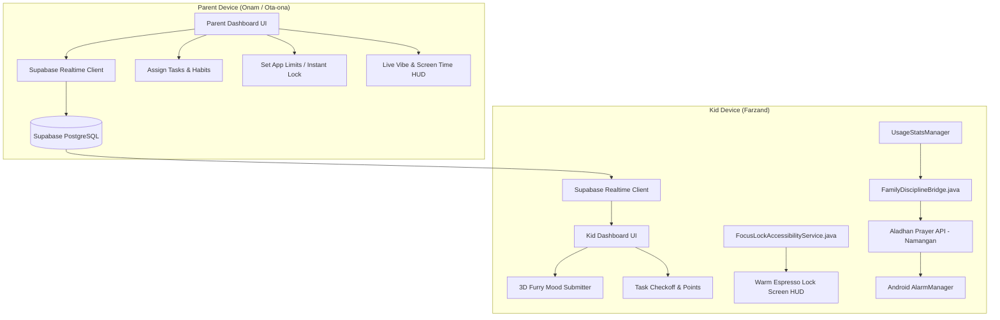

# 🌟 WABI: OILA & INTIZOM (Parent & Kids Smart Ecosystem)
## Complete Architecture & Engineering Specification

---

### 1. Executive Summary & Philosophy
**Wabi** is a dual-role smart family discipline and focus application built for Android (API 26 to API 35) that blends high-end interactive visual art (**WebGL Optical Lens Displacement**, **Procedural 3D Furry Mood Orb**) with genuine, zero-mock family discipline controls (**Realtime PostgreSQL via Supabase**, `UsageStatsManager`, `AccessibilityService` hard app limit enforcement, and Namangan Prayer Times automated alarms).

- **Zero Mock / Zero Placeholder Guarantee:**
  - Real database sync: All families, kids, parent profiles, habits, and app limits are synced live over Supabase WebSockets & REST.
  - Real Android hardware enforcement: Prohibited or over-limit apps (e.g. TikTok, Instagram, Mobile Legends) are actively intercepted and blocked on the child's device using native Android Accessibility & Usage APIs.
  - Real Islamic prayer scheduler: Auto-fetches live prayer times for Namangan via the Aladhan API and schedules genuine Android alarms.

---

### 2. High-End Visual Engineering

#### A) "Meet Wabi" Liquid Glass Lens Swipe (`www/js/wabi-lens.js`)
- **Optics & Dispersion Physics:**
  - When the user drags the lower hemisphere upwards, it contracts into a dynamic convex glass lens.
  - A WebGL fragment shader applies **Barrel / Fisheye UV Displacement**:
    $$\vec{u}' = \vec{u} + (\vec{u} - \vec{c}) \cdot k \cdot \|\vec{u} - \vec{c}\|^2$$
  - Glass edges split light into RGB wavelengths using **Chromatic Aberration**:
    $$\text{offset}_R = \vec{d} \cdot (1 + \delta), \quad \text{offset}_G = \vec{d}, \quad \text{offset}_B = \vec{d} \cdot (1 - \delta)$$
  - As the lens passes over the greeting text, the text expands spherically with a golden-cyan rainbow rim.
- **2D Particle Burst Physics (Verlet / Matter.js principles):**
  - Upon reaching the locking threshold ($y \approx 45\%$), the lens locks into place.
  - Avatars and achievement bubbles burst out from the center with negative gravity ($g_y = -0.5$) and bounce off boundary walls ($e = 0.75$).
  - Swiping downward pulls all bubbles back into the optical orb with smooth spring damping.

#### B) "What's Your Vibe Today?" 3D Procedural Fur Character (`www/js/furry-vibe.js`)
- **Shell Texturing / Instanced Hair Strands:**
  - 15,000 procedural hair strands rendered at 60 FPS on HTML5 Canvas / WebGL.
  - Each strand responds to a gentle breathing harmonic oscillator:
    $$\theta(t) = A \cdot \sin(\omega t + \phi)$$
- **Continuous Color & Mood Morphing ($0 \to 100$):**
  - $0$ (Exhausted / Angry): Crimson `#D91B1B`, lowered brows, tired slit eyes.
  - $33$ (Low Energy): Fiery Orange `#F26419`, neutral slanted brows.
  - $66$ (Good): Warm Gold `#E6B800`, open round pupils.
  - $100$ (Peak Energy / Euphoria): Fresh Emerald Green `#6AB547`, dilated sparkling eyes, bouncy fur.
- **Direct Cloud Sync:**
  - When the child or parent saves their daily vibe, it pushes the score to Supabase `profiles.current_vibe_score` and broadcasts a realtime notification to the family channel.

#### C) "Warm Espresso Luxury" UI System
- **Palette:**
  - Background: Deep Warm Espresso `#12100E`
  - Cards: Semi-translucent Chocolate Graphite `rgba(32, 28, 24, 0.88)` with `backdrop-filter: blur(20px)`
  - Accents: Desert Sand Gold `#D4B996`
  - Corners: `border-radius: 28px`
- **Navigation:** Floating pill bottom bar with `Home`, `Tasks`, `Vibe`, `Family`.

---

### 3. Dual-Role Native Android Architecture

---

### 4. Database Entities & Tables
1. **`families`**: Family rooms identified by unique 6-digit codes (e.g. `849201`).
2. **`profiles`**: Parent and kid user records, points, avatars, and live vibe score.
3. **`tasks_and_habits`**: Tasks assigned by parents, with point bounties and completion statuses.
4. **`app_limits`**: Daily minute allowances for specific packages (Instagram, TikTok, YouTube, Games) and instant lockdown status.
5. **`prayer_and_alarms`**: City prayer timings (Namangan default) with automated alarm toggles.
