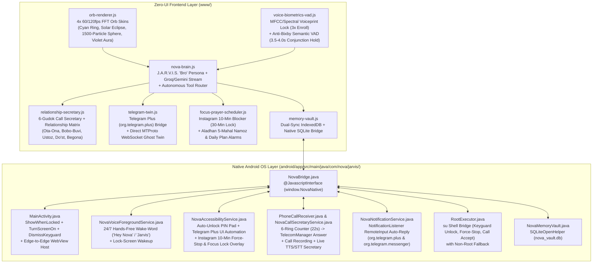

# NOVA (Nova-Jarvis) — Autonomous Android AI & Digital Twin Architecture

> **Target Platform:** Android 8.0 (API 26) through Android 15 (API 35)  
> **Artifact Name:** `Nova-Jarvis.apk` (`com.nova.jarvis`)  
> **Design Paradigm:** Zero-UI Ultra-Minimalism + 60/120 FPS Additive-Blending Orb + Hidden Glassmorphic Studio

---

## 1. Architectural Overview

**NOVA** is a modular, hybrid Native-Android + WebGL/Canvas2D autonomous personal AI assistant and **Digital Twin** ("Eng yaqin do'st / J.A.R.V.I.S."). Every subsystem is strictly isolated into its own single-responsibility module so that UI rendering, acoustic DSP/VAD, native Android OS automation, telephony, and persistent memory never tangle.



---

## 2. Directory & Module Structure

```text
c2q/
├── ARCHITECTURE.md                       # Complete system blueprint & module contracts
├── package.json                          # Asset sync & build scripts
├── scripts/
│   └── sync-assets.js                    # Syncs www/ into android/app/src/main/assets/public/
├── .github/
│   └── workflows/
│       └── build-apk.yml                 # CI/CD pipeline building & releasing Nova-Jarvis.apk
├── www/                                  # Zero-UI Frontend & Cognitive Engine
│   ├── index.html                        # Zero-UI Cosmic Canvas + Hidden Nova Studio Modal
│   ├── css/
│   │   └── nova-zero.css                 # #050314 / #000000 Zero-UI & Glassmorphism styles
│   └── js/
│       ├── orb-renderer.js               # 4x FFT Orb Skins + Long-Press (1.5s) / 2-Finger Swipe
│       ├── voice-biometrics-vad.js       # 3-Sample MFCC/Spectral Voiceprint + Semantic VAD
│       ├── memory-vault.js               # SQLite + IndexedDB Dual-Backed Memory Vault
│       ├── relationship-secretary.js     # Relationship Matrix + 6-Gudok Call Secretary AI
│       ├── telegram-twin.js              # Telegram Plus (org.telegram.plus) + MTProto Ghost Twin
│       ├── focus-prayer-scheduler.js     # Instagram 10m Blocker + Aladhan Namoz & Alarm Scheduler
│       ├── nova-brain.js                 # Autonomous J.A.R.V.I.S. "Bro" LLM & Intent Engine
│       └── app.js                        # Main lifecycle & Nova Studio UI binder
└── android/                              # Native Android (API 26 - API 35) OS Services
    └── app/src/main/
        ├── AndroidManifest.xml           # Full permissions, Lock-Screen flags, Services & Queries
        ├── res/xml/
        │   └── nova_accessibility.xml    # Accessibility config (gestures, windows, keyguard)
        └── java/com/nova/jarvis/
            ├── MainActivity.java                 # Lock-screen host, WebViewAssetLoader, permissions
            ├── NovaBridge.java                   # @JavascriptInterface connecting JS <-> Native OS
            ├── NovaVoiceForegroundService.java   # Hands-free 24/7 Wake-Word & Lock-Screen Wake
            ├── NovaAccessibilityService.java     # Auto-Unlock PIN, Telegram Plus UI, Focus Lock Overlay
            ├── PhoneCallReceiver.java            # BroadcastReceiver for CALL_STATE_RINGING
            ├── NovaCallSecretaryService.java     # 6-Gudok timer, Auto-Answer, Recorder & Live AI Talk
            ├── NovaNotificationService.java      # NotificationListener RemoteInput Twin Responder
            ├── FocusGuardianService.java         # UsageStatsManager + Instagram 10m session monitor
            ├── NovaMemoryVault.java              # Persistent SQLite database (nova_vault.db)
            └── RootExecutor.java                 # Root (su) command runner with graceful API fallback
```

---

## 3. Core Subsystem Specifications

### 3.1 Zero-UI & 4x Audio-Reactive Orb Engine (`www/js/orb-renderer.js`)
- **Zero Visible Chrome:** In both Full-Screen (`#050314` / `#000000`) and Compact Bottom Pill modes, no buttons, borders, or navbars clutter the screen—only the living **Nova Orb** and minimalist center status typography.
- **4 Selectable FFT Orb Skins:**
  1. `cyan_ring` (**Nova Cyan Ring**): 4 overlapping liquid plasma rings (`#00F0FF`, `#0066FF`) with `lighter` additive blending.
  2. `solar_eclipse` (**Solar Eclipse**): Pitch-black core with razor-thin coronal flares (`#FF5500`, `#FFFFFF`).
  3. `quantum_sphere` (**Quantum Particle Sphere**): 1,500 3D projected points rotating in spherical coordinates and rippling with FFT frequency bins.
  4. `violet_aura` (**Violet Aura**): Soft harmonic multi-lobed aura (`#7B2CBF`, `#3A86FF`).
- **Hidden Nova Studio Trigger:** Opens only on a **1.5-second Long-Press** on the Orb or a **Two-Finger Swipe Up** gesture.

### 3.2 Voice Biometric Lock & Anti-Bixby Semantic VAD (`www/js/voice-biometrics-vad.js`)
- **3-Sample Acoustic Voiceprint Enrollment:** Extracts Fundamental Pitch ($F_0$), Formant Spectral Centroid ($F_1/F_2$), Spectral Rolloff, and Cadence Energy Ratio from 3 voice samples. Computes cosine similarity against the owner's stored vector before executing sensitive commands.
- **Semantic End-of-Turn VAD:** Standard assistants cut the user off during a 1-second breath pause. Nova inspects the live transcript's trailing tokens:
  - If the utterance ends with a conjunction or filler (`"va"`, `"keyin"`, `"ya'ni"`, `"yani"`, `"lekin"`, `"ammo"`, `"haligi"`, `"chunki"`, `"masalan"`, `"uchun"`, `"agar"`, `"deb"`), or lacks terminal clause structure, the silence threshold dynamically extends from `1.4s` to **`3.8s`**.

### 3.3 Lock-Screen Execution & Auto-Unlock Engine (`MainActivity.java`, `NovaAccessibilityService.java`, `RootExecutor.java`)
- `FLAG_SHOW_WHEN_LOCKED`, `FLAG_TURN_SCREEN_ON`, `FLAG_KEEP_SCREEN_ON`, and `KeyguardManager.requestDismissKeyguard()` allow Nova to appear over the lock screen on Android 8.0–15.
- When the owner says *"Hey Nova, qulfni och"* (and Voice Biometrics pass):
  1. **Root Path (if `su` available):** Runs `su -c "input keyevent 82 && sleep 0.3 && input text <PIN> && input keyevent 66"`.
  2. **Non-Root Accessibility Path:** Performs an upward swipe gesture (`GestureDescription`) to reveal the PIN pad, locates digit nodes (`0-9`) on the keyguard window, taps each digit of the saved PIN, and taps Enter/OK.

### 3.4 6-Gudok Call Secretary & Relationship Matrix (`PhoneCallReceiver.java`, `NovaCallSecretaryService.java`, `relationship-secretary.js`)
- Monitors `TelephonyManager.CALL_STATE_RINGING`. Counts **6 rings (≈ 22 seconds)**.
- If the user has not answered by the end of the 6th ring, on the **7th ring** Nova:
  1. Answers the call automatically via `TelecomManager.acceptRingingCall()` (with Root `input keyevent 5` and Accessibility fallback).
  2. Starts recording audio (`MediaRecorder` `VOICE_COMMUNICATION` / `MIC`) into `/sdcard/Android/data/com.nova.jarvis/files/CallRecordings/`.
  3. Identifies the caller's category in the **Relationship Matrix** and speaks/listens live:
     - **OTA-ONA / BOBO-BUVI (`Onam`, `Dadam`, `Bobom`, `Buvim`):** Highest respect, warm, polite `"siz"` form.
     - **USTOZLAR (`Ustoz`):** Respectful, formal student-assistant tone.
     - **DO'STLAR (`Jamshid`, friends):** Warm, casual `"bro"` tone.
     - **BEGONA (Unknown number):** Cautious, screening tone asking who they are and the purpose of the call.
  4. Saves the audio recording and an AI-generated text summary to `NovaMemoryVault`.

### 3.5 Telegram Plus (`org.telegram.plus`) & Digital Twin Mode (`NovaNotificationService.java`, `NovaAccessibilityService.java`, `telegram-twin.js`)
- First-class support for **`org.telegram.plus` (Telegram Plus)** alongside `org.telegram.messenger`.
- **Mode 1 — Notification & Accessibility UI Bridge:** Reads incoming Telegram Plus notifications and replies instantaneously in the background via `RemoteInput`, or launches `org.telegram.plus` and navigates Search -> Chat -> Send via Accessibility.
- **Mode 2 — Direct MTProto / GramJS WebSocket Userbot ("Ghost Twin Mode"):** Connects via Phone Number + API ID + API Hash inside Nova Studio and auto-replies in the owner's exact style based on the sender's Relationship Matrix category.

### 3.6 Focus Guardian (Instagram 10-Minute Blocker) & Prayer/Plan Scheduler (`FocusGuardianService.java`, `focus-prayer-scheduler.js`)
- **Instagram 10-Minute Blocker:** Tracks continuous foreground usage of `com.instagram.android`. At 10 minutes:
  - Speaks: *"Bro, Instagramda 10 minutdan beri o'tiribsan, maqsadlardan chalg'ima, yopamiz!"*
  - Forces Instagram closed (`GLOBAL_ACTION_HOME` + Root `am force-stop com.instagram.android`).
  - Activates a **30-minute cooldown**: any attempt to reopen Instagram during the next 30 minutes immediately displays a full-screen black **Focus Lock Overlay** over Instagram.
- **5-Mahal Namoz & Daily Plan Scheduler:** Fetches daily prayer timings (`Bomdod`, `Peshin`, `Asr`, `Shom`, `Xufton`) from `api.aladhan.com/v1/timingsByCity?city=Namangan&country=Uzbekistan&method=2` (or GPS), sets silent-UI system alarms (`AlarmClock.ACTION_SET_ALARM` with `EXTRA_SKIP_UI = true`), and manages daily study/coding/sport schedules.
